<p align="center">
  
</p>

# Awesome Privacy-First Web Analytics & Traffic Tracking

[](https://awesome.re)
[](#)
[](#)
[](LICENSE)
[](https://github.com/ishandutta2007/Awesome-Privacy-First-Web-Analytics-Traffic-Tracking/pulls)

> **The definitive directory of privacy-first web analytics platforms, cookieless traffic tracking engines, and self-hosted open-source telemetry software.**

Accelerated by global privacy regulations (GDPR, CCPA, PECR, ePrivacy) and widespread browser deprecation of third-party tracking cookies, modern web teams are discarding heavy, invasive analytics suites like legacy Google Analytics. Privacy-first web analytics solutions substitute invasive user fingerprinting and cross-site behavioral tracking with lightweight client scripts (`<1 KB`), anonymized daily salted IP hashes, server-side log parsers, and strict 100% data ownership.

---

## Table of Contents

- [Sector Overview & Market Dynamics](#sector-overview--market-dynamics)
- [Key Benefits of Privacy-First Tracking](#key-benefits-of-privacy-first-tracking)
- [SaaS & Hosted Analytics Platforms](#saas--hosted-analytics-platforms)
- [Open-Source GitHub Projects](#open-source-github-projects)
- [Architectural Patterns & Implementation Guide](#architectural-patterns--implementation-guide)
- [Comparison Matrix: SaaS vs Self-Hosted](#comparison-matrix-saas-vs-self-hosted)
- [How to Contribute](#how-to-contribute)
- [Disclaimer](#disclaimer)

---

## Sector Overview & Market Dynamics

The global web analytics market is valued between **$7.4 billion and $9.8 billion in 2025–2026** and is projected to expand to over **$24 billion by 2030** at an estimated CAGR of 15% to 22.5%. 

The sector features a **moderately concentrated top layer alongside a highly fragmented lower tier**: enterprise tech giants (Google Analytics and Adobe Analytics) command bulk market volume, while the alternative and privacy-focused space is **highly fragmented**, populated by agile cookieless SaaS vendors, bootstrapped niche innovators, and self-hosted open-source telemetry engines thriving in response to European GDPR enforcement, browser privacy guardrails, and corporate demand for sovereign data governance.

---

## Key Benefits of Privacy-First Tracking

- **Zero Cookie Banners Needed**: Avoid cookie consent pop-ups under GDPR, ePrivacy Directive, and PECR by collecting zero personally identifiable information (PII) and eschewing persistent client identifiers.
- **Ultra-Fast Performance**: Scripts typically weigh `< 1 KB` compared to Google Analytics / GTM (`> 45 KB`), preserving perfect Google Core Web Vitals (LCP, FID, INP).
- **Ad-Blocker Resilience**: First-party reverse proxying and lightweight server beacons eliminate artificial traffic underreporting caused by browser tracking preventions.
- **100% Sovereign Data Ownership**: Self-hosted architectures keep proprietary telemetry inside your own VPC, ClickHouse cluster, or PostgreSQL database.

---

## SaaS & Hosted Analytics Platforms

The table below highlights leading hosted solutions, ordered by company scale (**revenue / valuation descending**):

| Product | Company Scale (Valuation / Revenue) | Pricing (Starting Tier) | Free Tier Limit / Free Trial | Key Capabilities & Highlights |
| :--- | :--- | :--- | :--- | :--- |
| **[Cloudflare Web Analytics](https://cloudflare.com)** | **$65B+ Market Cap** ($2.17B Annual Revenue) | **$0.00 / month** (100% Free) | **Free forever with unlimited traffic** (Unlimited proxied sites; up to 10 non-proxied beacon sites; 6-month historical retention) | Cookieless edge analytics, zero fingerprinting, Core Web Vitals telemetry directly from Cloudflare's global edge network. |
| **[PostHog Cloud](https://posthog.com)** | **$1.4B Valuation** (~$50M+ ARR) | **$0.00 / month** ($0.00005/event after free allowance) | **Free forever plan: 1,000,000 events/month**, 5,000 session replays/mo, 100k error tracking events/mo, and unlimited seats | Comprehensive product operating system with cookieless web tracking, session recordings, conversion funnels, and feature flags. |
| **[Plausible Analytics (Cloud)](https://plausible.io)** | **$3.1M+ ARR** (Bootstrapped & Profitable) | **$9.00 / month** ($90/year for 10k pageviews) | **30-day free trial** with full platform access and zero credit card required (No permanent free tier) | Gold-standard lightweight (`<1 KB`) cookieless dashboard with custom event goals, UTM campaigns, and EU-based data hosting. |
| **[Matomo Cloud](https://matomo.org)** (InnoCraft) | **~$2M–$5M ARR** (InnoCraft Ltd) | **$23.00 / month** (scales with tracked actions) | **21-day free trial** with full premium features (Heatmaps, A/B testing, funnels) and zero credit card required | Enterprise digital analytics suite with 100% data isolation, heatmaps, form analytics, and advanced tag manager. |
| **[Fathom Analytics](https://usefathom.com)** | **~$1.2M ARR** (Bootstrapped) | **$15.00 / month** (for up to 100,000 monthly pageviews) | **7-day free trial** with full feature access and up to 50 included sites (Credit card required upfront) | Privacy-first website analytics pioneer featuring EU data isolation, ad-blocker bypassing custom domains, and uptime monitoring. |
| **[Simple Analytics](https://simpleanalytics.com)** | **~$585k ARR** (Public Open Startup) | **€15.00 / month** (for Starter plan) | **Free forever Hobby plan** (1 user, 5 websites, 1 month retention, requires badge) or **14-day free trial** on paid plans | Clean, minimalist, privacy-by-design dashboard with built-in AI querying, email digests, and zero personal data storage. |
| **[Pirsch Analytics](https://pirsch.io)** | **Seed-stage / Growing** (Bootstrapped GmbH) | **$6.00 / month** (for 10,000 monthly pageviews) | **30-day free trial** with unlimited websites and full API/event access without credit card (No permanent free tier) | German-engineered cookieless web analytics with first-party proxy SDKs, backend tracking libraries, and conversion value goals. |
| **[Wide Angle Analytics](https://wideangle.co)** | **Micro-SaaS** (Input Objects GmbH) | **€8.33 / month** (Historical pricing) | **14-day free trial** with full features (Service officially sunsetted in August 2026; listed for historical taxonomy) | European GDPR-first analytics platform designed for businesses requiring strict compliance without annoying cookie consent prompts. |
| **[Counter.dev](https://counter.dev)** | **Open-Source / Community Donations** | **€0.00 / month** (Pay-what-you-want donation) | **Free forever plan with unlimited personal usage** (Community sponsored, optional voluntary contribution) | Minimalist, zero-cookie visitor analytics engine focused on high-speed in-memory aggregation and extreme operational cost efficiency. |

---

## Open-Source GitHub Projects

Explore the leading self-hosted and open-source web telemetry engines, ranked in **descending order by GitHub star count**. Each star badge links directly to that repository's stargazers community:

| Repository & Link | Stars | Technology Stack | License | Description & Architectural Highlights |
| :--- | :--- | :--- | :--- | :--- |
| **[Netdata](https://github.com/netdata/netdata)** | [](https://github.com/netdata/netdata/stargazers) | C, Go, Python | GPL-3.0 | Real-time performance, traffic monitoring, and server-side request observability with zero frontend JavaScript and sub-second metrics. |
| **[PostHog Core](https://github.com/PostHog/posthog)** | [](https://github.com/PostHog/posthog/stargazers) | Python, TypeScript, ClickHouse | MIT | Full-featured product and analytics platform with cookieless tracking modes, session replays, feature flags, and real-time event ingestion. |
| **[Umami](https://github.com/umami-software/umami)** | [](https://github.com/umami-software/umami/stargazers) | Next.js, Node.js, Prisma, ClickHouse | MIT | Clean, ultra-popular Google Analytics alternative that collects no personal data, uses no cookies, and offers a sleek single-page dashboard. |
| **[Plausible Analytics](https://github.com/plausible/analytics)** | [](https://github.com/plausible/analytics/stargazers) | Elixir, Phoenix, ClickHouse, PostgreSQL | AGPL-3.0 | The industry benchmark for self-hosted lightweight (`<1 KB`) web analytics with daily rotating salt hashes and automated goal conversion tracking. |
| **[Beszel](https://github.com/henrygd/beszel)** | [](https://github.com/henrygd/beszel/stargazers) | Go, PocketBase | Apache-2.0 | Lightweight server resource, network traffic, and container monitoring hub delivering real-time telemetry with tiny CPU and memory footprints. |
| **[Matomo On-Premise](https://github.com/matomo-org/matomo)** | [](https://github.com/matomo-org/matomo/stargazers) | PHP, MySQL / MariaDB | GPL-3.0 | The most established open-source enterprise analytics system worldwide, delivering 100% data ownership, cookieless modes, and tag management. |
| **[GoAccess](https://github.com/allinurl/goaccess)** | [](https://github.com/allinurl/goaccess/stargazers) | C, Ncurses | MIT | Real-time web log analyzer and interactive dashboard parsing Nginx, Apache, Caddy, and Amazon S3/CloudFront logs completely without client scripts. |
| **[Rybbit](https://github.com/rybbit-io/rybbit)** | [](https://github.com/rybbit-io/rybbit/stargazers) | Rust, TypeScript, ClickHouse | AGPL-3.0 | High-performance cookieless web and product analytics platform built on ClickHouse with interactive real-time 3D globe traffic views and funnel tracking. |
| **[Kaneo](https://github.com/usekaneo/kaneo)** | [](https://github.com/usekaneo/kaneo/stargazers) | TypeScript, Node.js | MIT | Modern, fast open-source telemetry engine engineered with a clean self-hosted architecture focused on simplicity and sovereign workspace data. |
| **[OpenPanel](https://github.com/OpenPanel-dev/openpanel)** | [](https://github.com/OpenPanel-dev/openpanel/stargazers) | Rust, Next.js, ClickHouse | Apache-2.0 | Next-generation hybrid platform merging Plausible's straightforward web visitor metrics with Mixpanel-style event telemetry and funnels. |
| **[GoatCounter](https://github.com/arp242/goatcounter)** | [](https://github.com/arp242/goatcounter/stargazers) | Go, SQLite / PostgreSQL | EUPL-1.2 | Fast, single-binary, minimalist web analytics platform engineered for personal websites, documentation, and blogs with zero bloat. |
| **[Countly Community Edition](https://github.com/Countly/countly-server)** | [](https://github.com/Countly/countly-server/stargazers) | Node.js, MongoDB | AGPL-3.0 | Enterprise-scale product and mobile/web analytics platform featuring strict privacy controls, crash analytics, and self-hosted deployments. |
| **[Ackee](https://github.com/electerious/Ackee)** | [](https://github.com/electerious/Ackee/stargazers) | Node.js, MongoDB, GraphQL | MIT | Self-hosted, privacy-focused analytics engine utilizing multi-step anonymized hashing algorithms to track unique visitors without cookies. |
| **[Shynet](https://github.com/milesmcc/shynet)** | [](https://github.com/milesmcc/shynet/stargazers) | Python, Django, PostgreSQL | Apache-2.0 | Modern privacy-friendly web analytics platform that functions cleanly without cookies and can operate completely without JavaScript via 1x1 tracking pixels. |
| **[Tianji](https://github.com/msgbyte/tianji)** | [](https://github.com/msgbyte/tianji/stargazers) | TypeScript, React, PostgreSQL | AGPL-3.0 | All-in-one self-hosted workspace combining cookieless website analytics, uptime monitors, server status pages, and telemetry alerts. |
| **[Aptabase](https://github.com/aptabase/aptabase)** | [](https://github.com/aptabase/aptabase/stargazers) | Rust, TypeScript, ClickHouse | AGPL-3.0 | Privacy-first event analytics SDK built specifically for web, mobile (iOS/Android), and desktop apps with zero user profiling. |
| **[Litlyx](https://github.com/Litlyx/litlyx)** | [](https://github.com/Litlyx/litlyx/stargazers) | TypeScript, Node.js, ClickHouse | MIT | Developer-friendly open-source analytics platform offering sub-minute setup, custom KPI tracking, and AI-assisted traffic analytics. |
| **[Swetrix](https://github.com/swetrix/swetrix)** | [](https://github.com/swetrix/swetrix/stargazers) | TypeScript, NestJS, ClickHouse | AGPL-3.0 | Fully open-source and GDPR-compliant web analytics dashboard featuring performance monitoring, custom events, and automated alerts. |
| **[Counter.dev](https://github.com/ihucos/counter.dev)** | [](https://github.com/ihucos/counter.dev/stargazers) | Go, Redis | AGPL-3.0 | Ultra-lightweight web counter built with an in-memory Redis architecture and Golang backend to minimize server resource footprint to near zero. |
| **[Offen Fair Analytics](https://github.com/offen/offen)** | [](https://github.com/offen/offen/stargazers) | Go, Docker | Fair Source 0.9 | Fair web analytics tool featuring end-to-end encrypted usage telemetry where visitors retain full visibility and opt-in control over their data. |
| **[Medama](https://github.com/medama-io/medama)** | [](https://github.com/medama-io/medama/stargazers) | Go, DuckDB | Apache-2.0 | Fast, privacy-focused, single-binary web analytics server powered by DuckDB with a `<1 KB` tracker script and zero external dependencies. |
| **[AWStats](https://github.com/eldy/AWStats)** | [](https://github.com/eldy/AWStats/stargazers) | Perl | GPL-3.0 | Veteran log file analyzer generating graphical web, FTP, and mail server statistics purely from access logs with zero browser scripts. |

---

## Architectural Patterns & Implementation Guide

### 1. Daily Salted Hashing (Client Script Telemetry)
Most modern privacy-first tools (such as Plausible and Umami) derive unique visitor counts without persistent identifiers:
```
Visitor Identifier = SHA-256( Client_IP + User_Agent + Hostname + Daily_Salt )
```
Because the `Daily_Salt` changes every 24 hours at UTC midnight, it is mathematically impossible to track a visitor across consecutive days or link visits across multiple domains.

### 2. Zero-JS Server Log Ingestion (Pure Passive Telemetry)
For mission-critical privacy and zero client overhead, parse your web server access logs in real-time using tools like **GoAccess** or edge log pipelines:
```bash
# Real-time HTML dashboard from Nginx access logs
goaccess /var/log/nginx/access.log -o /var/www/html/stats.html --log-format=COMBINED --real-time-html
```

### 3. First-Party Reverse Proxy Routing
Route analytics beacon requests through your own domain or CDN (e.g., `analytics.yourdomain.com/api/send`) to prevent ad-blockers and privacy extensions from misclassifying privacy-compliant telemetry:
```nginx
# Nginx first-party reverse proxy snippet for Umami / Plausible
location /stats/api/send {
    proxy_pass http://127.0.0.1:3000/api/send;
    proxy_set_header Host $host;
    proxy_set_header X-Forwarded-For $remote_addr;
}
```

---

## Comparison Matrix: SaaS vs Self-Hosted

| Dimension | Managed SaaS (Plausible, Fathom, Umami Cloud) | Self-Hosted Open-Source (Umami, GoAccess, Plausible CE) |
| :--- | :--- | :--- |
| **Maintenance** | Zero overhead, automatic updates, high availability | Requires server configuration, DB backups, security updates |
| **Data Residency** | Hosted in vendor's EU/US data centers | 100% on your own infrastructure or private VPC |
| **Cost Profile** | Monthly subscription based on pageviews | Server/VPS hosting costs only ($5–$20/mo typically) |
| **Compliance** | Vendor acts as Data Processor under DPA | You are the sole Data Controller and Processor |
| **Customization** | Standard features and dashboard views | Full code and database access (ClickHouse/DuckDB/SQL) |

---

## How to Contribute

We welcome additions, corrections, and improvements from developers, privacy advocates, and open-source creators!

1. **Fork the repository** to your personal GitHub account.
2. **Add or modify entries** in `README.md`:
   - For SaaS products: Include Name, Link, Company Scale, Pricing, Free Tier / Trial limits, and Features.
   - For Open-Source: Include Name, GitHub repo link, Social star badge, Stack, License, and Description. Keep the table sorted by GitHub stars descending.
3. **Ensure factual accuracy** and verify links to official documentation or repositories.
4. **Submit a Pull Request** with a clear description of your update.

[](https://star-history.com/#ishandutta2007/Awesome-Privacy-First-Web-Analytics-Traffic-Tracking&Date)

---

## Disclaimer

- This repository is a curated community directory for educational and technical reference.
- While privacy-first analytics tools avoid persistent tracking cookies and invasive profiling, regional privacy frameworks (GDPR, ePrivacy Directive, CCPA, CPRA, DPDP Act) still require maintaining an accurate privacy policy describing your data collection practices.
- When self-hosting telemetry infrastructure, ensure proper access controls, TLS encryption in transit, and database retention policies are configured.

---

<p align="center">
  <sub>Built for indie hackers, privacy engineers, web developers, and open-source maintainers worldwide.</sub>
</p>
